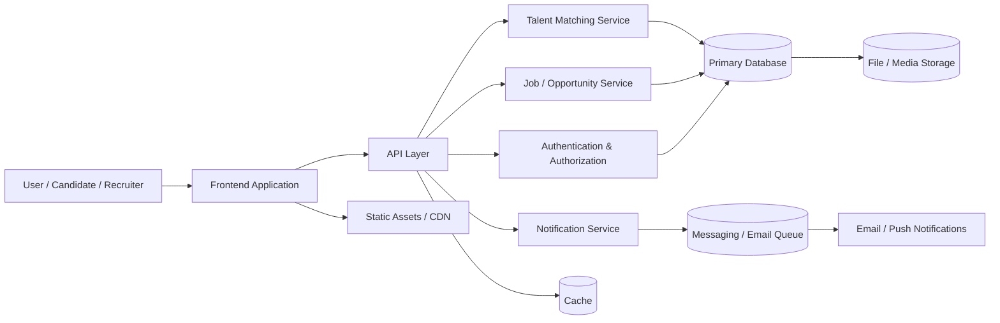

# TALA-HANE Architecture Overview

This document provides a high-level overview of the project's architecture.

## Architecture Notes

- Clients interact with the frontend application.
- The API layer coordinates requests across key business services.
- Authentication protects access to tenant and user-specific data.
- Core services handle talent matching, jobs, and notifications.
- Database and storage components provide persistence for application data and media.
- Caching and asynchronous messaging improve performance and responsiveness.
