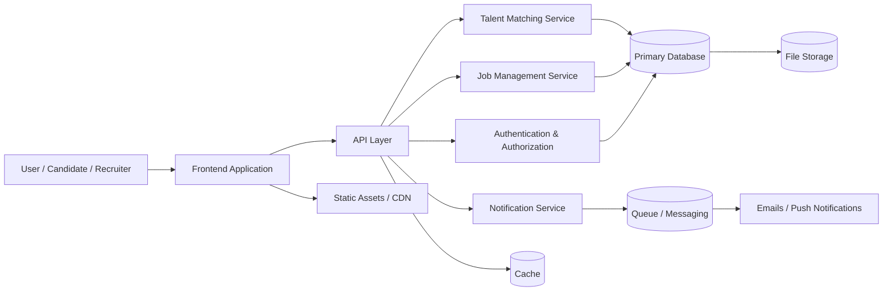

# TALA-HANE

YETENEK BENİM

TALA-HANE, yetenekleri keşfetmek, değerlendirmek ve doğru fırsatlara yönlendirmek amacıyla tasarlanmış bir platform fikrini temsil eder. Proje, insan kaynakları, kariyer ve yetenek yönetimi alanındaki iş akışlarını daha verimli hale getirmeyi hedefler.

## Amaç

- Yetenekleri merkezi bir yapıda yönetmek
- Başvuru ve değerlendirme süreçlerini düzenlemek
- İşverenler ile adaylar arasında daha güçlü eşleşmeler oluşturmak
- Kariyer ve işe alım deneyimini kolaylaştırmak

## Ana Özellikler

- Aday profili yönetimi
- Yetenek arama ve eşleştirme
- İş ilanı ve pozisyon takibi
- Başvuru ve değerlendirme akışı
- Bildirim ve iletişim desteği
- Gelişmeye açık modüler yapı

## Mimari Görünüm



## Proje Yapısı

```text
TALA-HANE/
├── ARCHITECTURE.md
├── MİNSEDD
├── README.md
└── src/                  # Uygulama kaynak kodları (gelecek geliştirmelerde)
```

## Geliştirme Notları

- Bu proje başlangıç aşamasında bir fikir ve mimari çerçeve olarak yapılandırılmıştır.
- Daha sonra frontend, backend, veritabanı ve API katmanları detaylandırılabilir.
- Mimari tasarım, ölçeklenebilirlik ve kullanıcı deneyimi odaklı şekilde genişletilebilir.

## Katkı

Projeye katkı sağlamak için yeni özellikler, iyileştirmeler veya dokümantasyon güncellemeleri eklenebilir.

## Lisans

Bu proje için lisans bilgisi eklenmemiştir. Geliştirme sürecinde uygun lisans dosyası eklenmelidir.
